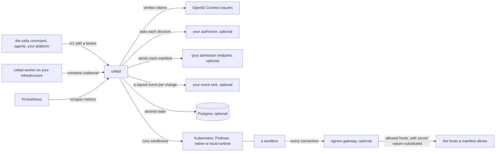

# Cella

**An open source control plane for sandboxes.** A manifest in the shape
of a Kubernetes object describes the environment an agent or a workload
runs in: its image, its resources, the credentials it may use, the hosts
it may reach, what it may spawn, and how long it lives. `cellad` makes
that environment exist on a data plane and lets you run commands, attach
a terminal, drive a screen, reach its ports, and move files in and out.
The data plane is a cluster or a machine `cellad` drives directly, or
your own infrastructure running a worker that connects outbound.
Identity comes from any OpenID Connect issuer. Permission comes from an
endpoint you write.

This repository is the whole control plane, and anyone can run it.

[](https://github.com/latere-ai/cella/actions/workflows/verify.yml)
[](https://github.com/latere-ai/cella/releases)
[](go.mod)
[](LICENSE)

## Status

Cella is before 1.0: its manifests are `cella.latere.ai/v1beta1`, a
release may still change the API or a manifest field, and the
[changelog](CHANGELOG.md) names every change in each
[release](https://github.com/latere-ai/cella/releases). A release
carries the signed `cellad` and `cella-display` images, the `cellad` and
`cella` binaries for Linux and macOS, and the Kubernetes manifests.

Everything under [What you get](#what-you-get) is served today. These are
designed and not built yet, and a manifest that asks for one is refused
with `capability_unsupported` or `unsupported_kind`, never accepted and
ignored:

| | |
|---|---|
| `SandboxSet` | the kind; the authorizer vocabulary names its actions, and the API does not serve it |
| More volume sources | a volume filled from a snapshot or an archive, on a named storage class, one that grows, and changing a sandbox's mounts after it is created |
| Workspace sources | a workspace filled from git or from a volume; `spec.workspace.source` takes `empty` |
| Public ports | `expose: public` on a port; no runtime provides one |
| Egress confined outside Kubernetes | the Podman and native runtimes declare no enforced egress mode, and neither does Kubernetes until its operator names the gateway's Pods; there a boundary other than `open` is recorded, the sandbox reports `EgressEnforced` false, and the create answers with a warning. The gateway still decides and records every connection that reaches it, and substitutes secret values |
| Ports and the desktop on a worker | for an environment a self-hosted worker serves |
| Virtual machines | a virtual machine runtime |

Cella has had no external security audit. The
[security policy](SECURITY.md#what-is-protected) names the test behind
each control it claims.

## The problem

An agent needs somewhere to run code that is not your machine and not
production: a Linux environment with the right image, a working tree
that outlives the process, credentials scoped to the task that the code
itself never sees, network access to the hosts the task needs, and a
lifetime that ends on its own. A training loop needs a thousand such
environments, each different, none kept warm. Sandbox services exist,
and each has its own API, its own idea of identity, its own account
system, and its own opinion about where the sandbox runs, so a platform
that composes one is written against that vendor.

Cella makes the environment a document and the control plane a
component you run.

## A sandbox

A manifest names what the sandbox runs and the boundary it runs inside:

```json
{
  "apiVersion": "cella.latere.ai/v1beta1",
  "kind": "Sandbox",
  "metadata": {"name": "dev"},
  "spec": {
    "image": "docker.io/library/python:3.13-alpine",
    "command": ["sleep", "3600"],
    "resources": {"cpu": "2", "memory": "4Gi"},
    "secrets": [{"name": "github-token", "env": "GITHUB_TOKEN"}],
    "network": {"ports": [{"name": "web", "port": 8080}]},
    "lifecycle": {"autoStop": "15m", "ttl": "24h"}
  }
}
```

The `cella` command applies it and works inside it:

```sh
cella apply -f github-token.json --value-from-env GITHUB_TOKEN
cella apply -f dev.json -w
cella exec dev -- python3 -c 'print("hello")'
cella cp ./src dev:/workspace/src
cella port-forward dev 8080:8080
cella delete sandbox dev
```

`GITHUB_TOKEN` inside the sandbox is a placeholder, not the token. The
egress gateway swaps it for the value on requests to the hosts the
`Secret` names, and nowhere else. What you read back from the API is the
manifest as it runs, with every default filled in and a `status` the
server writes.

## What you get

- **Four kinds.** `Sandbox`, `Secret`, `Volume`, and `Environment`,
  decoded strictly from JSON or YAML, with server-side defaults and one
  error code per refusal naming the field at fault.
- **Volumes.** Storage that outlives a sandbox, filled once from nothing
  or from an image pinned by digest, and mounted read-write by one
  sandbox or read-only by any number, on Kubernetes and Podman.
- **Runtimes.** Kubernetes (a claim and a Pod per sandbox), Podman (a
  container per sandbox), and a native runtime that runs host processes
  for trusted development. A `cellad worker` runs any of the three on
  your own infrastructure and connects outbound to a control plane
  somebody else operates.
- **A lifecycle.** Create, apply by name, start, stop, delete, idle
  auto-stop, a time to live, auto-delete after a stop, and recovery of a
  lost sandbox from desired state when state lives in Postgres.
- **Operations as streams.** Exec with or without a terminal, attach,
  logs, whole-tree and single-file transfers, ports reached through an
  HTTP proxy or a raw byte stream, and a virtual desktop with
  screenshots, a live screen, and pointer and keyboard input.
- **Secrets that stay out of the sandbox.** A `Secret` holds a value or
  an OAuth 2.0 client-credentials grant, stored under envelope
  encryption. The sandbox holds a placeholder, and the egress gateway
  substitutes the value toward the hosts the secret's owner scoped.
- **Identity inside every sandbox.** A workload token at
  `/run/cella/token`, verifiable offline against the published key set,
  re-minted before it expires and refused once its sandbox is gone.
- **Spawn and mesh.** A sandbox may create sandboxes within a budget and
  a depth, each child a subset of its parent, and a tree may share a
  private network.
- **Scheduling.** Start now or fail, or queue against an environment's
  capacity by priority and fair share, with preemption and warm pools of
  prewarmed sandboxes.
- **Three webhooks for your policy.** An authorizer decides every
  request, an admission endpoint rewrites or refuses every manifest, and
  a signed event sink receives one record per change. Each has a
  built-in default, so none is required.
- **A command and a skill.** `cella` speaks the API from a shell and from
  inside a sandbox, where it needs no flag and no login, and
  [`skills/cella`](skills/cella/SKILL.md) teaches an agent to use it.
- **A conformance suite** that holds any server claiming the API to it,
  including a platform's own front.
- **Packages to build on.** `manifest`, `runtime`, `controller`, and
  `egress` are what `cellad` is made of, for a platform that wants the
  contract in its own binary.
- **Signed releases.** Images, binaries, and a deploy archive, with SPDX
  bills of materials and build provenance.

## Quickstart

You need Go 1.27 or newer, `git`, `openssl` and `curl`. This starts the
control plane on your machine with stand-ins for the identity provider
and the endpoints you would write, creates a sandbox, and runs a command
in it:

```sh
git clone https://github.com/latere-ai/cella.git && cd cella
mkdir -p out
make run > out/run.log 2>&1 &
until grep -q 'export CELLA_TOKEN' out/run.log; do sleep 2; done
eval "$(grep '^  export CELLA_' out/run.log)"
curl --fail-with-body "$CELLA_URL/v1/sandboxes?wait=1" \
  -H "Authorization: Bearer $CELLA_TOKEN" -H 'Content-Type: application/json' \
  -d '{"apiVersion":"cella.latere.ai/v1beta1","kind":"Sandbox","metadata":{"name":"demo"},"spec":{"env":{"TASK":"hello"}}}'
curl --fail-with-body "$CELLA_URL/v1/sandboxes/demo/exec?wait=1" \
  -H "Authorization: Bearer $CELLA_TOKEN" -H 'Content-Type: application/json' \
  -d '{"command":["sh","-c","printf %s \"$TASK\""],"timeout":"10s"}'
```

The create answers with the manifest as it runs, every default filled
in and a `status` the server writes, and the command's output comes back
as one object:

```
{"apiVersion":"cella.latere.ai/v1beta1","kind":"Sandbox","metadata":{"name":"demo"},"spec":{...},"status":{"id":"sbx_01m6ptw3vmkrjctvy2s8dr9a43","driver":"native","isolation":"none","phase":"Running",...}}
{"exitCode":0,"stdout":"hello","stderr":"","truncated":false,"durationMs":5}
```

`make run` starts `cella-stubs`, which serves an OpenID Connect issuer,
an authorization endpoint, an admission endpoint and an event sink on
loopback, then `cellad serve` wired to the issuer, the authorization
endpoint and the sink, and prints the lines that
set `CELLA_URL` and mint a token for the subject `dev`, which the fifth
line runs. `kill %1` stops both, and `make clean` removes the keys and
records it keeps under `out/run/`. Port 8080 is the default; another
clone runs beside it with `CELLA_RUN_PORT=8090 make run`.

`make run` uses the native runtime, which runs commands on this host
with no isolation and no image, and `cella-stubs` is a test binary that
belongs in no installation. [Running it locally](docs/local.md) is what
the native runtime can and cannot do, and the rest of the API on it.

## How it fits



`cellad serve` is the control plane: it verifies every caller against
the issuers you list, asks your authorizer what they may do, lets your
admission endpoint rewrite or refuse each manifest, and sends your event
sink a signed record of each change. It runs sandboxes itself on a
cluster or a machine, or hands them to a `cellad worker` that runs them
on infrastructure it does not reach. `cellad egress` is the gateway a
sandbox's connections go through, and the only component a secret's
value is sent to.

## Install it

[`docs/install.md`](docs/install.md) goes from a cluster to a first
sandbox and `cellad check`. Every release publishes the image
`ghcr.io/<owner>/cellad:<tag>` under the account that pushed the tag, the
`cellad` and `cella` binaries for Linux and macOS, and
`deploy-<tag>.tar.gz`, the Kubernetes manifests with the image pinned by
digest.

You supply an OpenID Connect issuer, a signing key, a secret key, and a
hostname. An authorization endpoint, an event sink, Postgres, and an
egress gateway are each optional, and the manifests turn each one on with
one Secret. An admission endpoint is optional too.

## Identity

`cellad` knows who is calling and asks somebody else what they may do.
There is no anonymous access and no API key.

- **Who.** `CELLA_OIDC_ISSUERS` lists the issuers you trust. A bearer is
  accepted when a listed issuer signed it, its `aud` names an entry of
  `CELLA_OIDC_AUDIENCE` (`cella` by default), it has not expired, and it
  was minted less than 24 hours ago. A subject is the issuer and the
  `sub` joined, `https://login.example.com|alice`, and every claim of the
  token reaches your authorizer as it arrived.
- **What.** `CELLA_AUTHORIZER_URL` points at an endpoint you write, which
  answers allow or deny per subject, action, and object. Anything that is
  not a decision refuses the request. Unset, the built-in owner policy
  applies: you create anything but an environment, you act on what you
  own, and the subjects in `CELLA_ADMIN_SUBJECTS` act on everything.
  [Writing an authorizer](docs/authorizer.md) is the contract, and
  [`latere.ai/x/cella/authorizer`](authorizer) publishes the actions, so
  an endpoint written in Go keeps no copy of the strings.
- **What cellad signs.** `CELLA_TOKEN_KEY` is one or two RSA keys. The
  first signs every sandbox's identity and every environment key, and
  every key is published at `/.well-known/jwks.json`. A rotation is
  prepending a key and later removing the old one.

```sh
openssl genrsa -out token.pem 2048

CELLA_RUNTIME=podman CELLA_DATA_DIR="$PWD/state" \
CELLA_OIDC_ISSUERS=https://login.example.com \
CELLA_PUBLIC_URL=https://cella.example.com \
CELLA_TOKEN_KEY="$(cat token.pem)" \
CELLA_ADMIN_SUBJECTS='https://login.example.com|alice' \
  cellad serve
```

[`docs/configuration.md`](docs/configuration.md) is every variable, and
[`docs/plane.md`](docs/plane.md) is how the authorizer, the admission
endpoint, and the event sink fit a platform of your own.

## Documentation

| | |
|---|---|
| [Running it locally](docs/local.md) | `make run`, and a sandbox on your own machine with no cluster and no isolation |
| [Install](docs/install.md) | a cluster, the release's manifests, the first sandbox, and `cellad check` |
| [Configuration](docs/configuration.md) | every environment variable, its default, and which role reads it |
| [The cella command](docs/cli.md) | the client: commands, output, and exit codes |
| [Manifests](docs/manifest.md) | every field of `Sandbox`, `Secret`, and `Environment`, with defaults |
| [API](docs/api.md) | the `/v1` routes, authentication, errors, and the OpenAPI document |
| [Sandboxes on Kubernetes](docs/kubernetes.md) | what a sandbox on a cluster can do, what it can reach, and what the Role allows |
| [Self-hosting a data plane](docs/workers.md) | running sandboxes on your own machines with `cellad worker` |
| [Sandboxes on your own computer](docs/local-runtime.md) | the local runtime: a worker on a person's computer, the folders it grants, and the network it allows |
| [Capacity and queues](docs/scheduling.md) | capacity, queues, priority, preemption, and warm pools |
| [Following events](docs/events.md) | an object's history and the live feed |
| [Observability](docs/observability.md) | metrics, traces, logs, and alert rules |
| [Security](docs/security.md) | what Cella guarantees, what it sees and keeps, what it does not defend, and what an operator keeps safe |
| [Writing an authorizer](docs/authorizer.md) | the question `cellad` asks, the actions, the answer, and failing closed |
| [Building a plane](docs/plane.md) | a platform on top of Cella, through the webhooks or the packages |
| [Conformance](docs/conformance.md) | running the suite against an installation |

[`docs/README.md`](docs/README.md) is the index, and
[`deploy/README.md`](deploy/README.md) is the reference for the manifests.

## Contributing

[`CONTRIBUTING.md`](CONTRIBUTING.md) is how to build and test a change,
the quality bar, and where a package belongs. The design, and the
reasoning behind each decision, is in [`specs/`](specs/README.md).
[`SECURITY.md`](SECURITY.md) is what the project protects and where to
report a vulnerability; please do not open an issue for one.

## License

Apache-2.0. See [LICENSE](LICENSE).
